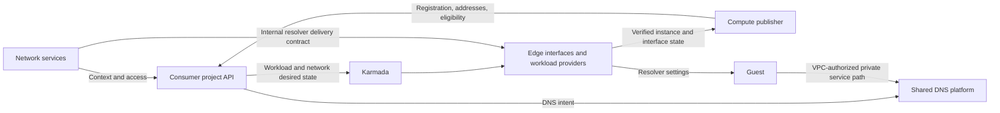

# Internal DNS for Compute instances

Tracking issue: [Internal DNS for Galactic VPC](https://github.com/datum-cloud/enhancements/issues/921).

- [Summary](#summary)
- [Motivation](#motivation)
  - [Goals](#goals)
  - [Non-Goals](#non-goals)
- [Proposal](#proposal)
  - [User stories](#user-stories)
  - [Risks and mitigations](#risks-and-mitigations)
- [Design Details](#design-details)
  - [Integration boundaries](#integration-boundaries)
  - [Names and search domains](#names-and-search-domains)
  - [Resolver configuration](#resolver-configuration)
  - [Record publication](#record-publication)
  - [Lifecycle and health](#lifecycle-and-health)
- [Production Readiness Review Questionnaire](#production-readiness-review-questionnaire)
- [Implementation History](#implementation-history)
- [Drawbacks](#drawbacks)
- [Alternatives](#alternatives)
- [Infrastructure Needed](#infrastructure-needed)

## Summary

Compute instances attached to a virtual private cloud (VPC) receive private DNS
names and resolver settings automatically. Compute publishes each instance's
private addresses to the internal DNS platform. Users can reach instances by
name without selecting a DNS zone or managing address records.

## Motivation

Instance addresses change as workloads scale, restart, or move. Automatic names
let users identify individual instances without maintaining address lists.
Resolution must remain isolated to the authorized VPC, including when VPCs use
overlapping addresses or private zone names.

### Goals

- Assign an instance identity name within each attached VPC's managed namespace.
- Resolve short instance names within the attached VPC.
- Configure guest resolvers from verified network-interface settings.
- Publish IPv4 and IPv6 host addresses only while their network attachment is valid.
- Bound stale answers when instances disappear or publishers lose connectivity.

### Non-Goals

- Workload-level service discovery and application health policies.
- Public DNS publication, custom per-instance zone selection, and DNS serving engines.
- Supporting several managed DNS contexts within one guest in the initial release.

## Proposal

Network services selects `datum.internal` as the default domain for VPCs with
managed DNS enabled and requests the zone from DNS. DNS manages a separate zone
within each VPC's context. Compute reads the allocated suffix and reserves an
instance name in that zone. The name remains stable for that instance's
lifetime; a replacement instance receives a distinct identity. Additional names
can follow the VPC's DNS naming policy without adding a zone choice to each
Compute resource.

Workload providers apply the resolver settings supplied by network services.
DNS publication and guest resolver configuration have separate status from
Compute readiness so users can distinguish naming problems from runtime failures.

### User stories

A user attaches a workload to a VPC and queries an instance's assigned name
from another instance in that VPC:

```console
$ cat /etc/resolv.conf
nameserver fd53::53
search datum.internal
$ dig +search +short A web-01
10.20.0.10
$ dig +short AAAA web-01.datum.internal.
fd20::10
```

Instance names and addresses are illustrative; `datum.internal` is the proposed shared
default domain. DNS supplies the canonical name; consumers do not construct it
from a workload display name.
The example resolver file describes effective settings; runtimes can apply them
through their native resolver configuration. `dig` requires
[`+search`](https://bind9.readthedocs.io/en/stable/manpages.html#dig-dns-lookup-utility)
to use the configured search list.

When an address is released, subsequent answers omit it after withdrawal and
client-cache expiry. An application failing its readiness check does not remove
the instance identity name, which can still support diagnostics.

### Risks and mitigations

- Cross-VPC publication: pin project, VPC, context, and registration lifetimes;
  scope publisher permissions through project RBAC.
- Stale addresses: publish explicit eligibility changes and retain the last
  reported state when observations are unavailable. Retention has no maximum
  age; see [Lifecycle and health](#lifecycle-and-health).
- Name collisions: the oldest registration keeps a contested name and others
  report `NameConflict`; see [Name uniqueness](#name-uniqueness).
- Incorrect guest resolution: apply verified settings and reject
  unsupported combinations of managed contexts across interfaces.

## Design Details

### Integration boundaries



Compute discovers project identities through Milo, including newly created
projects, and uses authenticated project clients for publication. It identifies the
VPC's context through trusted project and Network UIDs, matching the
`DNSResolverContext.spec.consumerID` contract. DNS does not read Compute objects
to determine addresses or health.

Network services own resolver contexts, regional access, and interface DNS
settings. Galactic provides the authorized private service path. DNS owns zones,
name validation, publication status, and shared query serving. Compute does not
create access bindings or select serving replicas.

See the [DNS architecture proposal](https://github.com/datum-cloud/dns-operator/pull/229),
[VPC DNS integration proposal](https://github.com/datum-cloud/network-services-operator/pull/589),
and [Private Service Connect design](https://github.com/datum-cloud/galactic/blob/main/docs/enhancements/networking/private-service-connect/README.md)
for these contracts.

### Names and search domains

Use `<instance-name>.datum.internal` for instance identity in every VPC and `datum.internal` as the default search domain. The authorized DNS context scopes resolution to the attached network. Namespace, VPC, and project labels are not part of the default hostname.

Compute derives the label from the Instance name: it lowercases the name, replaces every character outside `[a-z0-9-]` with `-`, and trims leading and trailing hyphens. A label longer than 63 characters is cut to 46 characters and suffixed with a hash of the full Instance name. DNS supplies the canonical name in registration status; consumers read it from `Instance.status.dns` and do not construct it.

Two VPCs can resolve `web-01.datum.internal` to different addresses. The authorized DNS context selects the zone before lookup and cache access; matching domain names do not share records or grant access across VPCs.

#### Name uniqueness

Each VPC's managed zone is one flat namespace shared by every publisher: Compute instances, Connect exports, other products, and the customer's own static records. Instance names are unique only within a Kubernetes namespace, so Compute cannot guarantee that a label is free. Labels collide when two Instance names normalize to the same label (`web.01` and `web-01`), or when another publisher already holds the name.

DNS resolves every collision with one rule, defined in the [DNS architecture](https://github.com/datum-cloud/dns-operator/pull/229) under "Publication and service discovery": static records claim first, then the oldest registration by creation time, with the UID breaking ties. Compute does not add a suffix and does not retry under another name. For the losing Instance:

- Its `DNSRegistration` reports `Accepted=False` with reason `NameConflict` and publishes nothing.
- `Instance.status.dns` for that network lists no hostname and reports `Ready=False` with reason `NameConflict`.
- The Instance itself runs normally; only its name is missing.

When the holder's registration is deleted, the next oldest waiting registration takes the name on the next compilation. A recreated Instance gets a new registration with a new creation time, so it does not reclaim its previous name ahead of a registration that was already waiting. There is no hold on a name across instance replacement.

Today Compute publishes only for a Network in the Instance's own namespace; an interface on a Network in another namespace reports `Ready=Unknown` with reason `NetworkObservationUnavailable` and gets no name. Supporting cross-namespace attachments would make Instance-to-Instance collisions common and needs its own naming decision first.

> [!NOTE]
> Open question: whether a replacement Instance should keep its predecessor's name, for example through a short hold on the claim, and whether Compute should fall back to a suffixed label on `NameConflict`. Neither is designed; the current behavior is first-come by registration age.

#### Instances on several VPCs

Compute publishes one registration per Instance and attached VPC, each with that VPC's addresses only, so other guests on either VPC can resolve the Instance under the same label. The guest itself supports one managed DNS context in the initial release. A guest whose interfaces span two managed VPCs gets no managed resolver: the provider reports `DNSConfigured=False` with reason `UnsupportedMultipleContexts` instead of merging resolver settings, as the [VPC DNS integration](https://github.com/datum-cloud/network-services-operator/pull/589) defines. A guest with several interfaces on the same VPC receives that VPC's settings once.

#### Deferred: peered networks

Names for peered networks, such as qualified aliases or sharing a peer's zone, belong in the DNS and network services designs and are out of scope here. Compute publishes only into the managed zone of each VPC it attaches to.

Network services supply the managed domain and approved additional search domains. Compute providers apply and report the effective ordered list. Associating a private zone does not automatically add it to the search list.

### Resolver configuration

Network services owns resolver settings and delivers them as read-only `NetworkInterface.status.dns`; the [VPC DNS integration](https://github.com/datum-cloud/network-services-operator/pull/589) defines that contract and the `DNSConfigured` condition. Customers select the network; they do not supply resolver settings or authorization.

Compute providers apply the settings from the current interface status through the runtime's native resolver configuration and report `DNSConfigured` on the interface:

- `True` with reason `Applied` after the settings are in effect in the guest.
- `False` with reason `UnsupportedMultipleContexts` when the guest's interfaces span more than one managed DNS context.

Providers reconcile updates and ignore stale revisions. Applied settings persist during control-plane outages. A resolver failure must not send private names to a public resolver. The runtime-specific guest configuration mechanism requires joint review with network services before implementation; no Compute provider reports `DNSConfigured` yet.

### Record publication

Compute publishes through the DNS-owned `DNSRegistration` and `DNSRecordContribution` resources. Their schema and validation are defined by the [dns-operator API types](https://github.com/datum-cloud/dns-operator/blob/fix/internal-dns-name-references/api/v1alpha1/internaldns_project_types.go) ([dns-operator#244](https://github.com/datum-cloud/dns-operator/pull/244)); this document describes only what Compute writes.

For each Instance and attached VPC, Compute finds the ready `DNSResolverContext` whose `consumerID` is `<project UID>/<Network UID>` and creates, in the project namespace:

- one `DNSRegistration` in the context's managed zone, with the label from [Names and search domains](#names-and-search-domains), record types `A` and `AAAA`, and a 30 second TTL;
- one `DNSRecordContribution` that pins the registration's name, UID, and generation and carries the addresses and eligibility together.

Both are named from a hash of the Instance UID and VPC UID and are owned by the project-side Instance, so deletion and replacement clean them up through garbage collection even without a final reconcile. Compute refuses to publish from an edge copy whose UID does not match the project Instance.

Project RBAC permits the Compute publisher to manage registrations and contributions. Network services manages resolver access separately. DNS validates current registration references, resolves name conflicts, and orders publication internally.

Consumers read assigned names and publication readiness from `Instance.status.dns`:

```yaml
status:
  dns:
    - network:
        name: application
        namespace: production
      # Names allocated by DNS within this network.
      hostnames: [web-01.datum.internal]
      # Publication is reported independently of runtime readiness.
      conditions:
        - type: Ready
          status: "True"
          reason: Published
          message: Private name is published
          observedGeneration: 1
          lastTransitionTime: "2026-10-09T20:00:00Z"
```

The `Ready` condition reports `Published`, `PendingPublication`, `NameConflict`, `AddressUnavailable`, `PublicationFailed`, or, with status `Unknown`, `NetworkObservationUnavailable`.

### Lifecycle and health

Addresses come from the Instance's `NetworkInterface` allocations, not from the runtime Pod, because not every runtime reports Pod IPs ([compute#518](https://github.com/datum-cloud/compute/pull/518)). Each allocated host address is published as-is; for a delegated IPv6 block, Compute publishes the block's first address, which Galactic configures as the guest address. Each interface contributes only addresses from its own VPC.

An interface is eligible only when it is allocated and programmed for the Instance's current lifetime and location, its runtime Pod exists, and the Pod's node is healthy. The Pod and node gate eligibility; they do not supply addresses.

Address release, network deprogramming, or Instance deletion triggers an ineligible update and cleanup. Failed API observations and unknown runtime health retain published state and report unknown readiness. Confirmed unhealthy state or deletion withdraws records explicitly. Client caches follow the advertised TTL.

> [!IMPORTANT]
> Accepted risk: published records have no maximum age. If Compute cannot observe an Instance, for example during a Compute or project API outage, DNS keeps serving its last reported addresses until Compute reports again or the records are withdrawn. This matches the dns-operator decision to keep applied configuration through control-plane outages rather than expire it ([dns-operator#229](https://github.com/datum-cloud/dns-operator/pull/229), "Publication and service discovery"). A stale answer is preferred over losing every name during an outage.

Workload service discovery needs a separate registration and explicit application eligibility policy. It must withdraw unhealthy endpoints and accept recovery only from a fresh observation. That capability requires a separate Compute API proposal before implementation.

## Production Readiness Review Questionnaire

### Feature Enablement and Rollback

Use the default-off `InternalDNSPublishing` feature gate for the publisher.
Provider application of managed resolver settings requires a separate rollout
control. Disabling publication stops updates and retains published records.
To remove published names, explicitly withdraw contributions before disabling
the publisher. Reenabling requires fresh observations. Test both controls
independently.

### Rollout, Upgrade and Rollback Planning

Enable staging for all projects and supported single-context guests. Extend
the shared Kubernetes end-to-end environment with actual Compute publishers
and providers. Require two isolated VPCs with overlapping names and addresses, UDP
and TCP queries from guests, outage continuity, address changes, deletion,
publisher outages, publisher RBAC isolation, stale replay, and restart coverage.
Test the same default domain and hostname with different answers across VPCs,
name collisions between product publishers, short-name resolution, fully
qualified queries, and explicit additional-zone search configuration.
Qualify guest configuration per runtime and mixed controller versions before
enabling production. These are release criteria, not validation claims.

### Monitoring Requirements

Expose assigned names and DNS publication conditions through `Instance.status.dns`.
Track publication lag,
observation failures, withdrawal delay, and guest configuration failures without
per-instance metric labels. Set latency and withdrawal targets before release.

### Dependencies

Project APIs and scoped authorization support publication. Network services,
Galactic, and the DNS fleet support resolver access. API outages stop fresh
observations; installed records and access persist until explicit withdrawal. DNS errors requeue independently of Compute runtime readiness.

### Scalability

Budget registrations per instance/VPC and contributions per interface. Measure
project API publication load and controller queues at fleet
scale. Spread observation polls with jitter and bound concurrent project operations.

### Troubleshooting

Trace the Instance and VPC lifetimes through context, registration, and
contribution status. Check network eligibility and publication conditions, then
compare inherited settings with guest configuration and query results.

## Implementation History

2026-10-09: Compute integration enhancement proposed.

## Drawbacks

Publication adds project API traffic and endpoint observation coordination. DNS outages can
interrupt applications that depend on assigned names despite a healthy runtime.

## Alternatives

User-managed records require consumers to track instance address changes.
Automatic publication keeps that lifecycle with Compute.

## Infrastructure Needed

Provision project-scoped publisher credentials, VPC resolver access, shared DNS
capacity, and the local Kubernetes validation
environment. This integration uses shared serving infrastructure across VPCs.
